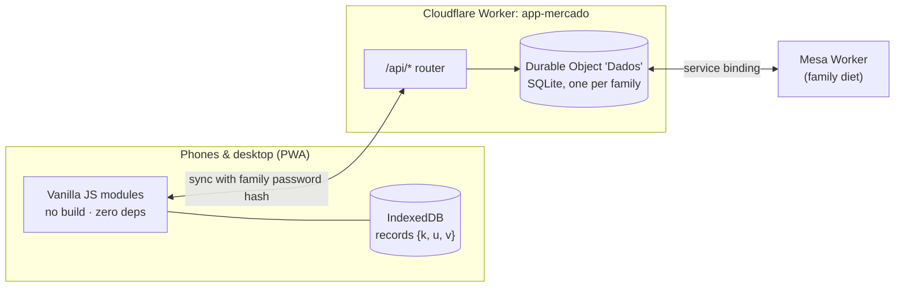

<p align="center"></p>

<h1 align="center">Cesta</h1>
<p align="center"><b>Grocery price research that pays for itself — compare stores, shop the cheapest route, audit the receipt.</b></p>

<p align="center">
  <a href="README.pt-BR.md">🇧🇷 Leia em português</a> ·
  <a href="#demo">Demo</a> ·
  <a href="#architecture">Architecture</a> ·
  <a href="#commercial-use">Commercial use</a>
</p>

<p align="center">
  
  
  
  
  
</p>

---

Cesta replaces the household's monthly grocery spreadsheet. Before shopping, prices are researched across several stores;
the app shows the cheapest store for each item, the total of the month at the best prices and the best route of stores to
visit. At the store it becomes a shopping checklist, captures the shelf price, and after paying it reads the electronic
receipt (Brazilian NFC-e) to check what was really charged.

> The interface is in Brazilian Portuguese. All prices, stores' receipts and data in this repository and in the images
> are fictitious.

## Demo

<p align="center"></p>

| Price research | One product, five stores | Shopping mode & route | Monthly history |
|---|---|---|---|
|  |  |  |  |

| Lists, receipts, assistant | Optimize the list | What's new |
|---|---|---|
|  |  |  |

**Desktop** — a spreadsheet view for people who think in rows and columns:


## What it does

**Research**
- One list per month (plus extra lists), products in categories, price per store with brand and package size.
- Cheapest store per item, total of the month at the best prices, price per kg / L / unit across package sizes,
  price-change alerts against previous months, accepted brands per product.
- Money input like a banking app, quantity repetition from last month, search and filters.

**Shopping**
- Shopping mode by store with a suggested route (e.g. "fewer stops: Sam's + Carrefour for only R$ 63 more"), budget per month or list
  (ok / almost / over), shelf price capture with an alert when it is ≥10% above plan and cheaper elsewhere.
- Shared between phones in real time when sync is on.

**After paying**
- Reads the electronic receipt (text copied from the tax authority page or a photo via the assistant), links each line to
  a product, learns the store's codes, and reports what was charged above the shelf or planned price.

**Assistant without a paid API**
- "Optimize the list": items usually bought and missing, duplicates, wrong categories, bigger package that is cheaper,
  items without price — each with a one-tap fix. Category suggestion from the product name (rule base + learned memory).
- Copy-and-paste prompts for Claude: receipts without QR code, category review, saving tips.

**Integrations & data**
- Pulls the shopping list of the family diet from [Mesa](https://github.com/BeBernos/Mesa-Business) (converted into
  packages by brand size) and sends back the price per gram/ml/unit, so Mesa can show what the diet costs.
- Imports and exports the original Excel spreadsheet format (`.xlsx` written from scratch with `CompressionStream`).

## Architecture



- **Local-first:** everything works offline; every record is `{k, u, v}` and the highest timestamp wins, deletions are
  tombstones — the same rule on every phone and on the server.
- **Optional sync:** a single Durable Object with SQLite (free plan). The family password never leaves the phone: the app
  sends a SHA-256 token and the server stores only a hash of it.
- **No build step, no dependencies:** plain ES modules, service worker cache, a hand-written `.xlsx` reader/writer.

## Quality

- 44 tests with Node's built-in runner covering the model (prices, totals that match the original spreadsheet, budgets,
  receipts, linking, route, assistant rules, diet packaging and pricing).
- A Playwright end-to-end run of the full app (two phones, offline, receipts, spreadsheet, the Mesa integration with both
  Workers running locally).

## Run it locally

```bash
npm test
npx wrangler dev --port 8787        # http://localhost:8787 (sync + diet integration)
# or just serve the app/ folder: it works offline without the server
```

## Commercial use

This repository is **source-available, not open source**: you may read and evaluate the code, but production or commercial
use requires a license. Licenses are available for **white-label deployments** (supermarket loyalty apps, purchasing
co-ops, budgeting and financial-education products) and custom development. See [LICENSE](LICENSE) and get in touch through
[github.com/BeBernos](https://github.com/BeBernos).

## Part of a suite

| | |
|---|---|
| [**Mesa**](https://github.com/BeBernos/Mesa-Business) | Family nutrition plan, planned by AI |
| [**Pulse**](https://github.com/BeBernos/Pulse-Business) | Strength training with AI-built programs and 2D/3D exercise animations |
| **Cesta** | Grocery price research (this repository) |
