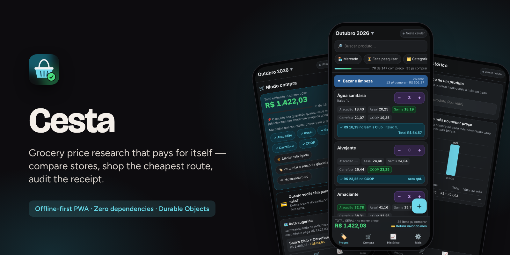
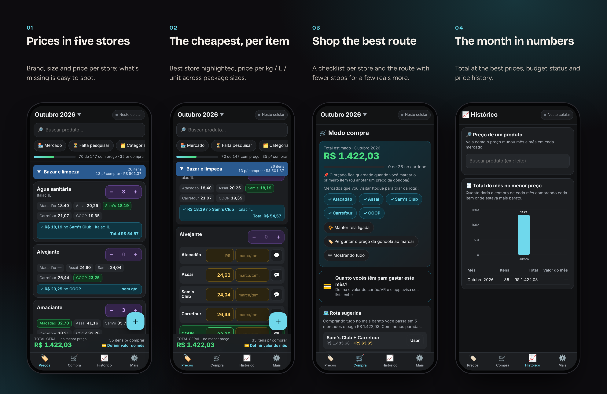
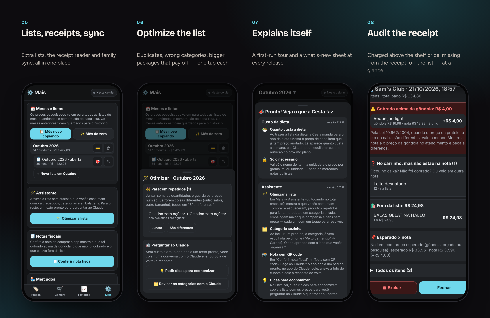
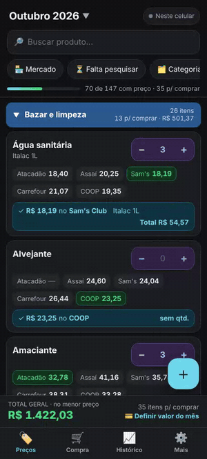
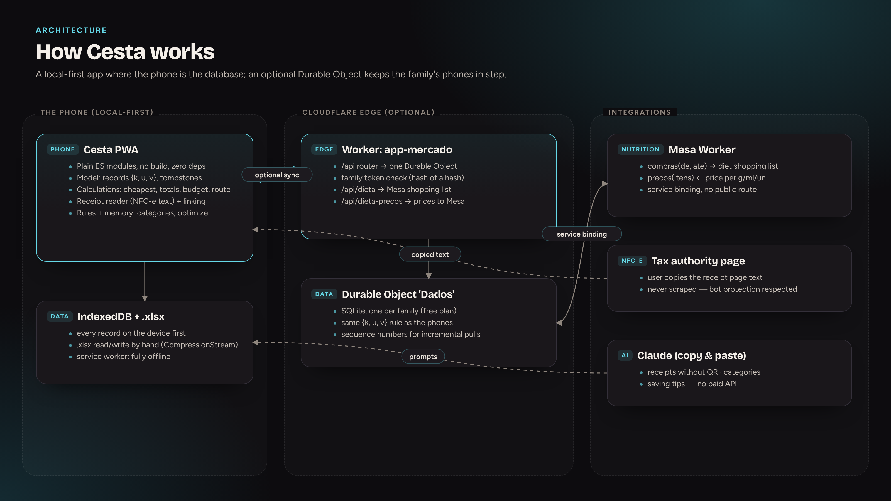
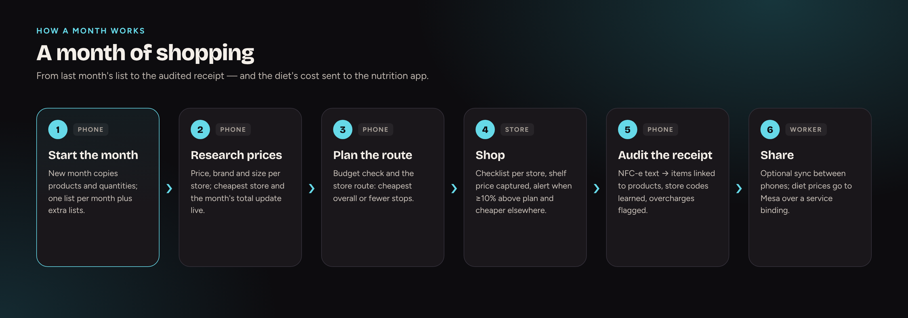

  <a href="https://bebernos.github.io/Cesta-Business/"><b>▶ Live demo</b></a> ·
  <a href="README.pt-BR.md">Leia em português</a> ·
  <a href="#how-it-works">Architecture</a> ·
  <a href="SECURITY.md">Security</a> ·
  <a href="docs/case-study.md">Case study</a>

  
  

# Cesta

**Cesta replaces the household's monthly grocery spreadsheet: prices are researched across several stores, the app shows
where each item is cheapest and the best route of stores to visit, turns into a checklist at the store, and reads the
electronic receipt afterwards to check what was really charged.**

It was built for the person who does the family's shopping and has been used every month since October 2026, replacing a
spreadsheet with one tab per month. Fourteen releases later it also prices the family's diet for the nutrition app (Mesa).

**At a glance:** 14 releases · used monthly since Oct 2026 · 5 stores × 147 products · 0 dependencies · works fully offline

> The live demo opens with the ready-made list of 147 products and **fictitious prices** in five stores, generated in your
> browser. It works offline; nothing leaves your browser.

## What it does

 <i>Prices per store, the cheapest one highlighted, then shopping mode with the suggested route and the month's history.</i>

**In detail**
- **Research** — one list per month plus extra lists, price per store with brand and size, cheapest store per item, total at
  the best prices, price per kg / L / unit, price-change alerts, accepted brands, money input like a banking app.
- **Shopping** — a checklist per store, a suggested route, a monthly budget, the shelf price with an alert when it's ≥10%
  above plan and cheaper elsewhere, shared between phones.
- **After paying** — the NFC-e receipt linked to products, store codes learned, overcharges and missing items flagged.
- **Spreadsheet** — imports and exports the family's original Excel format.

## How it works

Cesta is **local-first**: the phone is the database and the app is complete without a server. Sync is an optional layer — one
Cloudflare Durable Object per family — that applies exactly the same merge rule as the phones.

**On the device** — Every fact is a record `{k, u, v}` in IndexedDB: the key says what it is (a product, a price in a store in a month, a receipt, a learned link), `u` is the timestamp and the highest wins; deleting writes a tombstone. All calculations — cheapest store, totals, budget, route, receipt audit — are pure functions over those records, so they work offline and are easy to test.

**Learning without AI** — Linking receipt lines to products and suggesting categories combine conservative rules with what the family did before (learned codes and descriptions); on a tie, the app asks instead of guessing.

**At the edge** — The Worker routes `/api/*` to one Durable Object with SQLite. A sequence number per write lets each phone pull only what's new. The family token is a SHA-256 of the password and the server keeps only a hash of it.

**Receipts** — The app reads the text of the tax authority's public receipt page, which the user copies — it never scrapes the page, which is protected against bots. Personal identifiers are discarded on parsing.

**Integrations** — Through the Durable Object, Cesta pulls the diet's shopping list from the nutrition app (Mesa), converts grams and millilitres into packages by brand size, and sends back the price per gram/ml/unit so Mesa can show the diet's cost.

### The flow

### Design decisions

| Decision | Why |
|---|---|
| **The phone is the database** | It works in any store aisle, with or without signal. |
| **Same merge rule everywhere** | Phones and server converge with `{k, u, v}` + tombstones; no special cases. |
| **Copied text, not scraping** | Respects the tax authority's bot protection and never breaks when the page changes its markup. |
| **Zero dependencies** | Even the `.xlsx` reader/writer is hand-written; nothing to update, nothing to audit but our code. |

## Security

Sync is protected by a family password that never leaves the phone: the app sends a SHA-256 token and the server keeps only
a hash of it. Receipt parsing discards personal identifiers (tax ID, name, membership number). Links are accepted only from
`https://*.gov.br`. Details in [SECURITY.md](SECURITY.md).

## Engineering highlights

- **Zero dependencies, no build** — plain ES modules, service-worker cache, a hand-written `.xlsx` (ZIP + XML) reader/writer.
- **Numbers that match the spreadsheet** — an optional test compares the app's monthly totals with the original Excel file, to the cent.
- **Receipt reader** tested against a real (anonymised) NFC-e, including codes, quantities, discounts and store mapping.
- **Learning without AI** — product/receipt linking and category suggestions learn from what the family does, with rules
  that never guess when there's a tie.
- **44 model tests** plus a Playwright end-to-end run of the whole app: two phones, offline mode, receipts, the spreadsheet,
  and the integration with the nutrition app with both Workers running locally.

## Tech stack

JavaScript (ES2023, no framework) · IndexedDB · Service Worker · CompressionStream (.xlsx) · Cloudflare Workers · Durable
Objects (SQLite) · Service bindings · Claude (copy & paste prompts) · Node.js test runner · Playwright

## Read more

- [Case study](docs/case-study.md) — the problem, the decisions and what came out of them.
- [Security](SECURITY.md) — threat model and how each layer works.

## The suite

| | |
|---|---|
| [**Lastro**](https://github.com/BeBernos/Lastro-Business) | Family finance hub — cash flow, credit card and investments, encrypted end to end |
| [**Mesa**](https://github.com/BeBernos/Mesa-Business) | Family nutrition plan, planned by AI |
| [**Pulse**](https://github.com/BeBernos/Pulse-Business) | Strength training with AI-built programs and 2D/3D exercise animations |
| **Cesta** | Grocery price research (this repository) |

## About

Designed and built by **Bruno Bernos** — product, UX and engineering — working with Claude Code as a pair programmer.
Contact: [github.com/BeBernos](https://github.com/BeBernos).

## License

Copyright © 2026 Bruno Bernos. **All rights reserved.** The source is published for evaluation only; no permission is
granted to use, copy, modify or distribute it. Commercial licenses (supermarket and loyalty apps, purchasing co-ops,
budgeting and financial-education products) are available — see [LICENSE](LICENSE) and get in touch.
