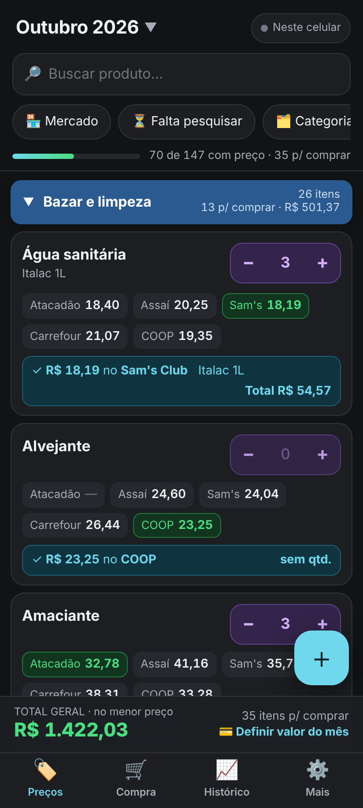
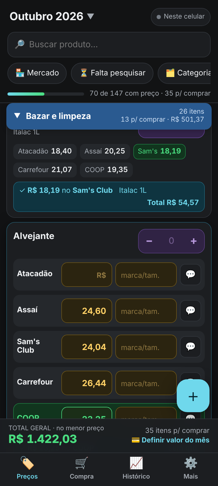
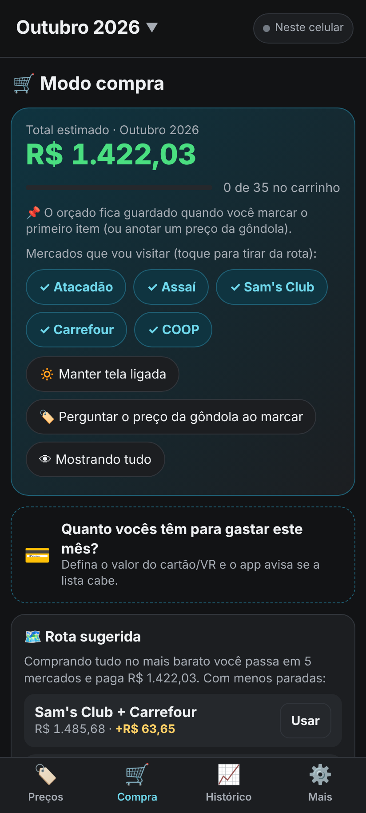
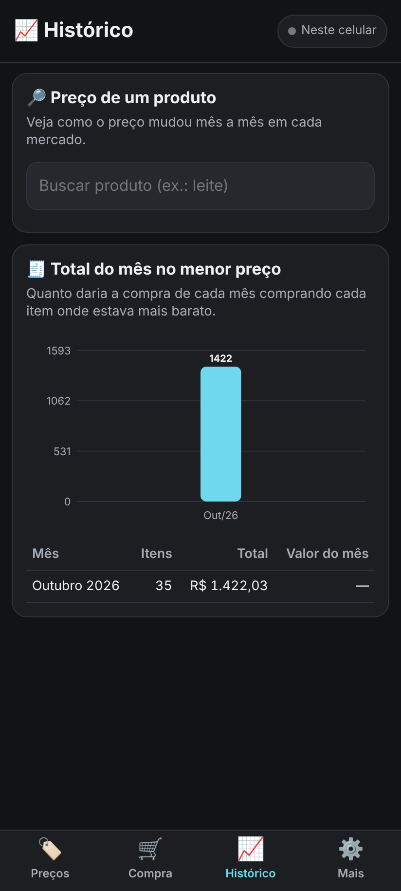
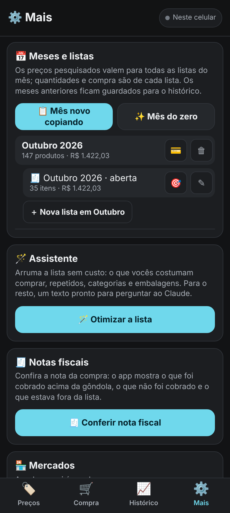
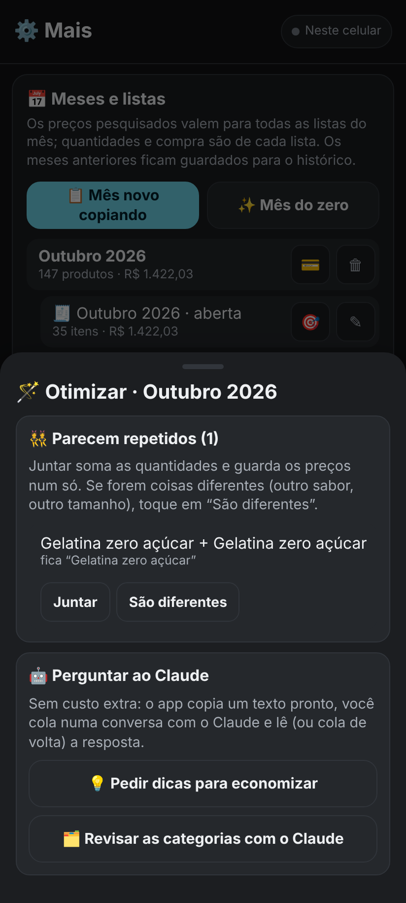
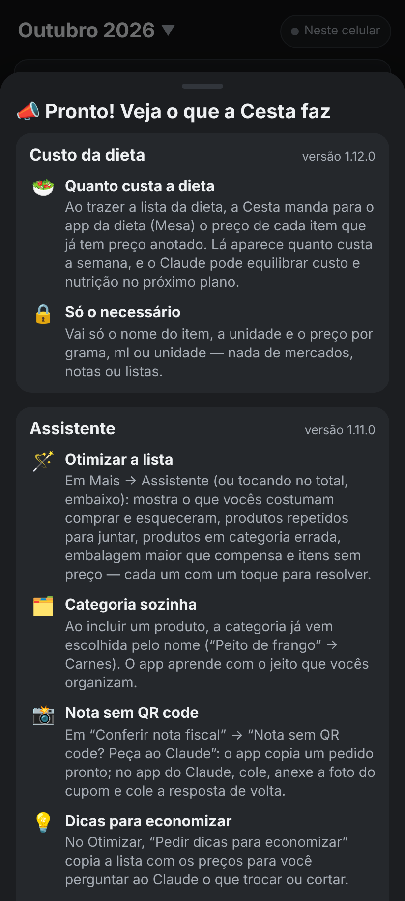
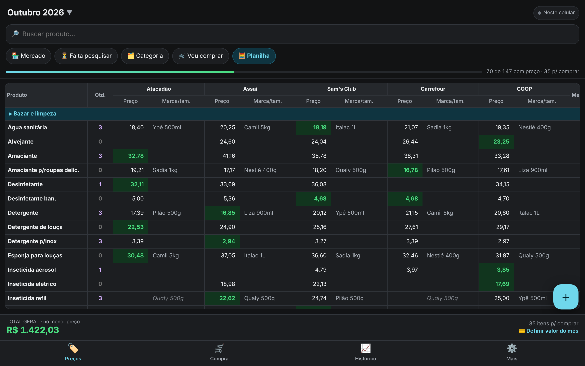
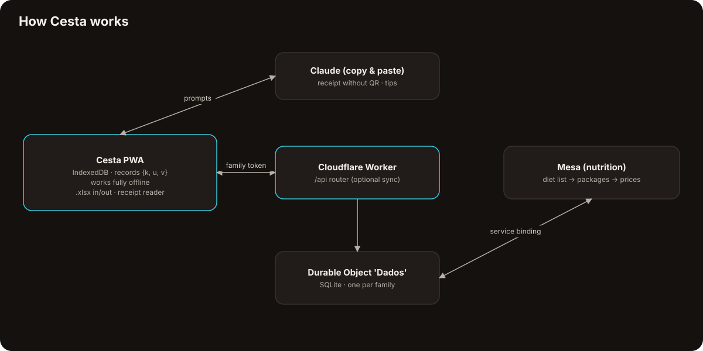

  <a href="https://bebernos.github.io/Cesta-Business/"><b>▶ Live demo</b></a> ·
  <a href="README.pt-BR.md">Leia em português</a> ·
  <a href="#how-it-works">Architecture</a> ·
  <a href="SECURITY.md">Security</a> ·
  <a href="docs/case-study.md">Case study</a>

  
  

# Cesta

**Cesta replaces the household's monthly grocery spreadsheet: prices are researched across several stores, the app shows
where each item is cheapest and the best route of stores to visit, turns into a checklist at the store, and reads the
electronic receipt afterwards to check what was really charged.**

It was built for the person who does the family's shopping and has been used every month since October 2026, replacing a
spreadsheet with one tab per month. Fourteen releases later it also prices the family's diet for the nutrition app (Mesa).

> The live demo opens with the ready-made list of 147 products and **fictitious prices** in five stores, generated in your
> browser. It works offline; nothing leaves your browser.

## What it does

| | | | |
|:---:|:---:|:---:|:---:|
|  **Prices in five stores** |  **Cheapest store per item** |  **Shopping mode & route** |  **History of the month** |
|  **Lists, receipts, assistant** |  **Optimize the list** |  **What the app does** |  **Spreadsheet view on desktop** |

 
<i>Prices per store, the cheapest one highlighted, then shopping mode with the suggested route and the month's history.</i>

- **Research** — one list per month (plus extra lists), price per store with brand and package size, the cheapest store per
  item, the month's total at the best prices, price per kg / L / unit across package sizes, price-change alerts against
  previous months, accepted brands per product, money input like a banking app.
- **Shopping** — a checklist per store with a suggested route ("fewer stops: two stores for R$ 63 more"), a monthly budget
  (ok / almost / over), the shelf price captured on the spot with an alert when it is ≥10% above plan and cheaper
  elsewhere, shared between phones in real time.
- **After paying** — reads the Brazilian electronic receipt (NFC-e), links each line to a product, learns each store's codes
  and reports what was charged above the shelf or planned price.
- **Assistant without a paid API** — "Optimize the list" (usually bought but missing, duplicates, wrong categories, bigger
  package that is cheaper, items without price) with one-tap fixes; category suggestions from the product name; ready
  prompts to paste into Claude for receipts without a QR code and saving tips.
- **Spreadsheet in and out** — imports and exports the family's original Excel format, so nothing was lost in the move.

## How it works

The unusual part: **the phone is the database.** Every fact — a price, a quantity, a brand, a receipt line — is a record
`{k, u, v}` in IndexedDB; the highest timestamp wins and deletions are tombstones. The app works fully offline, and sync is
optional: a single Cloudflare Durable Object (SQLite) stores the same records for the family, applying the same rule. There
is no build step and no dependency — even the `.xlsx` reader and writer are written by hand on top of `CompressionStream`.

The receipt reader works from the text of the tax authority's public page (copied by the user), not by scraping: the page
is protected against automated access and the app respects that.

## Security

Sync is protected by a family password that never leaves the phone: the app sends a SHA-256 token and the server keeps only
a hash of it. Receipt parsing discards personal identifiers (tax ID, name, membership number). Links are accepted only from
`https://*.gov.br`. Details in [SECURITY.md](SECURITY.md).

## Engineering highlights

- **Zero dependencies, no build** — plain ES modules, service-worker cache, a hand-written `.xlsx` (ZIP + XML) reader/writer.
- **Numbers that match the spreadsheet** — an optional test compares the app's monthly totals with the original Excel file, to the cent.
- **Receipt reader** tested against a real (anonymised) NFC-e, including codes, quantities, discounts and store mapping.
- **Learning without AI** — product/receipt linking and category suggestions learn from what the family does, with rules
  that never guess when there's a tie.
- **44 model tests** plus a Playwright end-to-end run of the whole app: two phones, offline mode, receipts, the spreadsheet,
  and the integration with the nutrition app with both Workers running locally.

## Tech stack

JavaScript (ES2023, no framework) · IndexedDB · Service Worker · CompressionStream (.xlsx) · Cloudflare Workers · Durable
Objects (SQLite) · Service bindings · Claude (copy & paste prompts) · Node.js test runner · Playwright

## Read more

- [Case study](docs/case-study.md) — the problem, the decisions and what came out of them.
- [Security](SECURITY.md) — threat model and how each layer works.

## The suite

| | |
|---|---|
| [**Lastro**](https://github.com/BeBernos/Lastro-Business) | Family finance hub — cash flow, credit card and investments, encrypted end to end |
| [**Mesa**](https://github.com/BeBernos/Mesa-Business) | Family nutrition plan, planned by AI |
| [**Pulse**](https://github.com/BeBernos/Pulse-Business) | Strength training with AI-built programs and 2D/3D exercise animations |
| **Cesta** | Grocery price research (this repository) |

## About

Designed and built by **Bruno Bernos** — product, UX and engineering — working with Claude Code as a pair programmer.
Contact: [github.com/BeBernos](https://github.com/BeBernos).

## License

Copyright © 2026 Bruno Bernos. **All rights reserved.** The source is published for evaluation only; no permission is
granted to use, copy, modify or distribute it. Commercial licenses (supermarket and loyalty apps, purchasing co-ops,
budgeting and financial-education products) are available — see [LICENSE](LICENSE) and get in touch.
