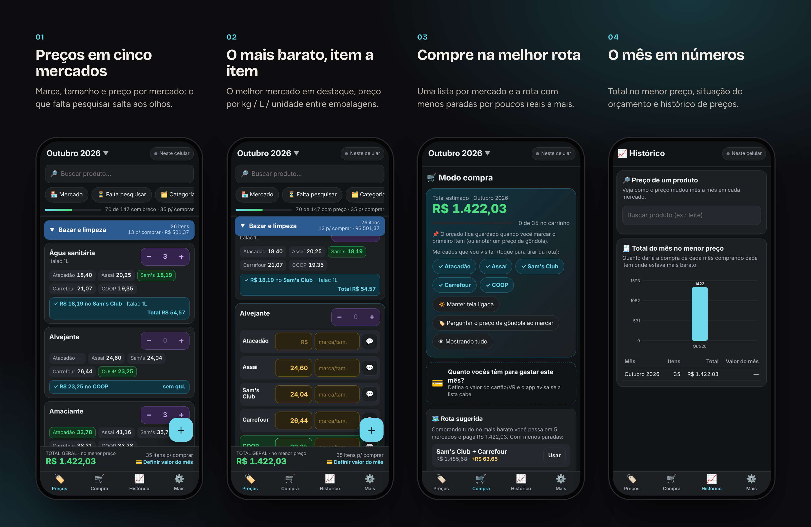
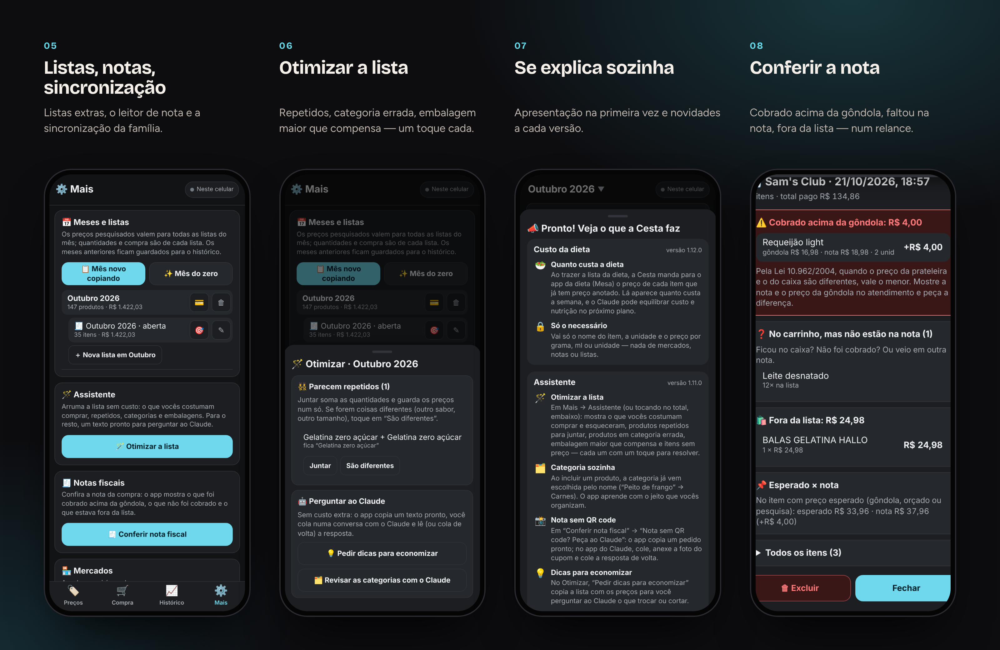
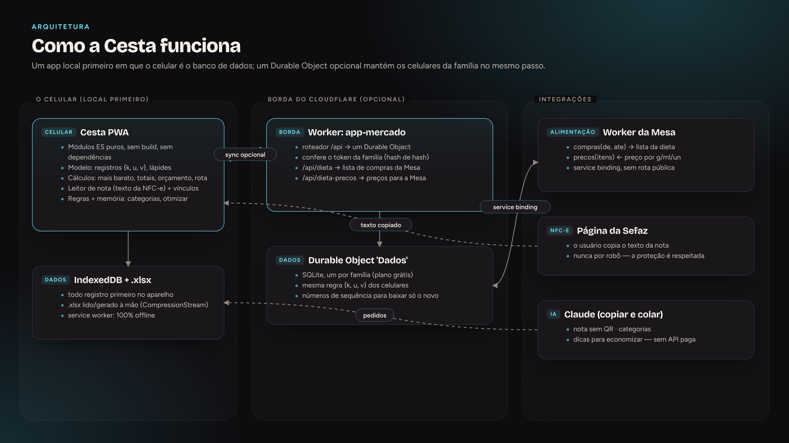
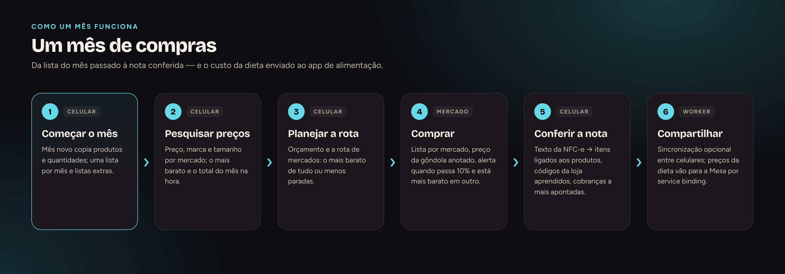

  <a href="https://bebernos.github.io/Cesta-Business/"><b>▶ Demonstração ao vivo</b></a> ·
  <a href="README.md">Read in English</a> ·
  <a href="#como-funciona">Arquitetura</a> ·
  <a href="SECURITY.md">Segurança</a> ·
  <a href="docs/case-study.pt-BR.md">Estudo de caso</a>

  
  

# Cesta

**A Cesta substitui a planilha de compras do mês da casa: os preços são pesquisados em vários mercados, o app mostra onde
cada item sai mais barato e a melhor rota de mercados, vira lista de compra na hora e lê a nota fiscal eletrônica depois
para conferir o que foi cobrado de verdade.**

Foi feita para quem faz as compras da família e é usada todo mês desde outubro de 2026, no lugar de uma planilha com uma
aba por mês. Catorze versões depois, ela também dá preço à dieta da família para o app de alimentação (Mesa).

**Em números:** 14 versões · uso mensal desde out/2026 · 5 mercados × 147 produtos · 0 dependências · funciona 100% offline

> A demonstração ao vivo abre com a lista pronta de 147 produtos e **preços fictícios** em cinco mercados, gerados no seu
> navegador. Funciona offline; nada sai do seu navegador.

## O que faz

 <i>Preços por mercado, o mais barato em destaque, depois o modo compra com a rota sugerida e o histórico do mês.</i>

**Em detalhe**
- **Pesquisa** — uma lista por mês e listas extras, preço por mercado com marca e tamanho, o mais barato de cada item, total no
  menor preço, preço por kg / L / unidade, aviso de variação, marcas aceitas, digitação de valor como app de banco.
- **Compra** — lista por mercado, rota sugerida, valor do mês, preço da gôndola com alerta quando passa 10% do previsto e está
  mais barato em outro mercado, compartilhada entre os celulares.
- **Depois de pagar** — a NFC-e ligada aos produtos, códigos da loja aprendidos, cobrança a mais e item faltando apontados.
- **Planilha** — importa e exporta o formato Excel original da família.

## Como funciona

A Cesta é **local primeiro**: o celular é o banco de dados e o app é completo sem servidor. A sincronização é uma camada
opcional — um Durable Object do Cloudflare por família — que aplica exatamente a mesma regra de junção dos celulares.

**No aparelho** — Cada fato é um registro `{k, u, v}` no IndexedDB: a chave diz o que é (um produto, um preço num mercado num mês, uma nota, um vínculo aprendido), `u` é o carimbo e vence o maior; apagar grava uma lápide. Todos os cálculos — mais barato, totais, orçamento, rota, conferência da nota — são funções puras sobre esses registros, então funcionam offline e são fáceis de testar.

**Aprender sem IA** — Ligar as linhas da nota aos produtos e sugerir categorias junta regras conservadoras com o que a família já fez (códigos e descrições aprendidos); no empate, o app pergunta em vez de chutar.

**Na borda** — O Worker leva `/api/*` a um Durable Object com SQLite. Um número de sequência por gravação deixa cada celular baixar só o que é novo. O token da família é o SHA-256 da senha e o servidor guarda só um hash dele.

**Notas fiscais** — O app lê o texto da página pública da nota na Sefaz, copiado pelo usuário — nunca por robô, porque a página é protegida contra acesso automático. Dados pessoais são descartados na leitura.

**Integrações** — Pelo Durable Object, a Cesta traz a lista de compras da dieta do app de alimentação (Mesa), converte gramas e mililitros em embalagens pelo tamanho da marca e devolve o preço por g/ml/unidade, para a Mesa mostrar o custo da dieta.

### O fluxo

### Decisões de projeto

| Decisão | Por quê |
|---|---|
| **O celular é o banco de dados** | Funciona em qualquer corredor de mercado, com ou sem sinal. |
| **A mesma regra em todo lugar** | Celulares e servidor convergem com `{k, u, v}` + lápides; sem casos especiais. |
| **Texto copiado, não robô** | Respeita a proteção da Sefaz e não quebra quando a página muda. |
| **Zero dependências** | Até o leitor/gerador de `.xlsx` é escrito à mão; nada para atualizar, nada para auditar além do nosso código. |

## Segurança

A sincronização é protegida por uma senha da família que nunca sai do celular: o app manda um token SHA-256 e o servidor
guarda só um hash dele. A leitura da nota descarta dados pessoais (CPF, nome, número de sócio). Links só são aceitos de
`https://*.gov.br`. Detalhes em [SECURITY.md](SECURITY.md).

## Destaques de engenharia

- **Sem dependências e sem build** — módulos ES puros, cache no service worker, leitor/gerador de `.xlsx` (ZIP + XML) à mão.
- **Números que batem com a planilha** — um teste opcional compara os totais do mês do app com o Excel original, centavo a centavo.
- **Leitor de nota** testado contra uma NFC-e real (anonimizada), com códigos, quantidades, descontos e o mercado da loja.
- **Aprende sem IA** — o vínculo produto/nota e a sugestão de categoria aprendem com o que a família faz, com regras que
  nunca chutam quando há empate.
- **44 testes do modelo** e um ponta a ponta com Playwright do app inteiro: dois celulares, offline, notas, planilha e a
  integração com o app de alimentação com os dois Workers rodando localmente.

## Tecnologias

JavaScript (ES2023, sem framework) · IndexedDB · Service Worker · CompressionStream (.xlsx) · Cloudflare Workers · Durable
Objects (SQLite) · Service bindings · Claude (pedidos para copiar e colar) · test runner do Node · Playwright

## Para ler mais

- [Estudo de caso](docs/case-study.pt-BR.md) — o problema, as decisões e o que saiu delas.
- [Segurança](SECURITY.md) — modelo de ameaças e como cada camada funciona.

## O conjunto

| | |
|---|---|
| [**Lastro**](https://github.com/BeBernos/Lastro-Business) | Finanças da família — caixa, cartão e investimentos, com criptografia de ponta a ponta |
| [**Mesa**](https://github.com/BeBernos/Mesa-Business) | Plano alimentar da família, montado por IA |
| [**Pulse**](https://github.com/BeBernos/Pulse-Business) | Treino de força com programas montados por IA e animações 2D/3D dos exercícios |
| **Cesta** | Pesquisa de preços de mercado (este repositório) |

## Sobre

Concebido e construído por **Bruno Bernos** — produto, UX e engenharia — com o Claude Code como par de programação.
Contato: [github.com/BeBernos](https://github.com/BeBernos).

## Licença

Copyright © 2026 Bruno Bernos. **Todos os direitos reservados.** O código está publicado só para avaliação; não há
permissão para usar, copiar, modificar ou distribuir. Há licenças comerciais (apps de supermercado e fidelidade,
cooperativas de compra, produtos de orçamento e educação financeira) — veja a [LICENSE](LICENSE) e fale comigo.
