
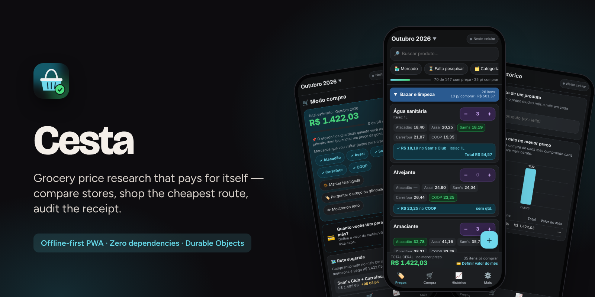

  <a href="https://bebernos.github.io/Cesta-Business/"><b>▶ Demonstração ao vivo</b></a> ·
  <a href="README.md">Read in English</a> ·
  <a href="#como-funciona">Arquitetura</a> ·
  <a href="SECURITY.md">Segurança</a> ·
  <a href="docs/case-study.pt-BR.md">Estudo de caso</a>

  
  

# Cesta

**A Cesta substitui a planilha de compras do mês da casa: os preços são pesquisados em vários mercados, o app mostra onde
cada item sai mais barato e a melhor rota de mercados, vira lista de compra na hora e lê a nota fiscal eletrônica depois
para conferir o que foi cobrado de verdade.**

Foi feita para quem faz as compras da família e é usada todo mês desde outubro de 2026, no lugar de uma planilha com uma
aba por mês. Catorze versões depois, ela também dá preço à dieta da família para o app de alimentação (Mesa).

> A demonstração ao vivo abre com a lista pronta de 147 produtos e **preços fictícios** em cinco mercados, gerados no seu
> navegador. Funciona offline; nada sai do seu navegador.

## O que faz

| | | | |
|:---:|:---:|:---:|:---:|
| 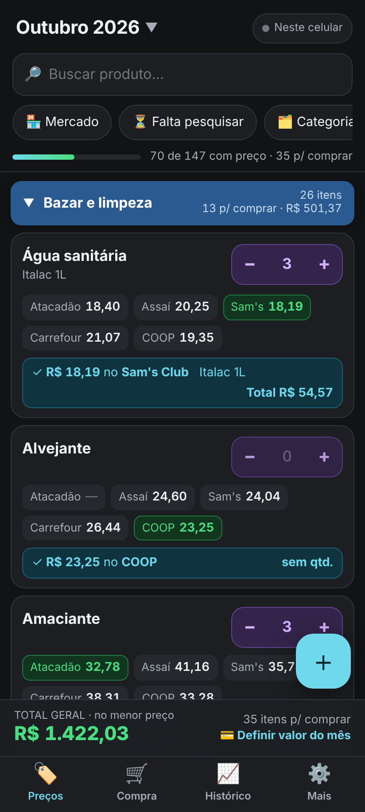 **Preços em cinco mercados** | 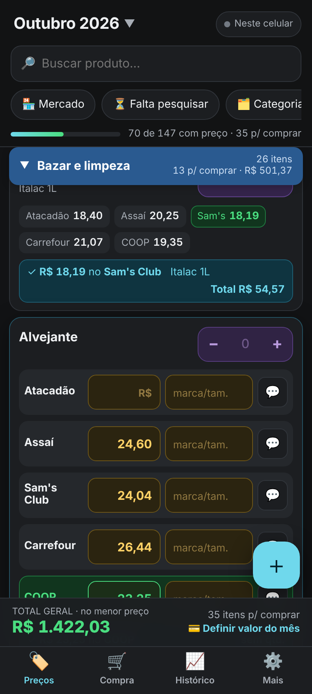 **O mais barato de cada item** | 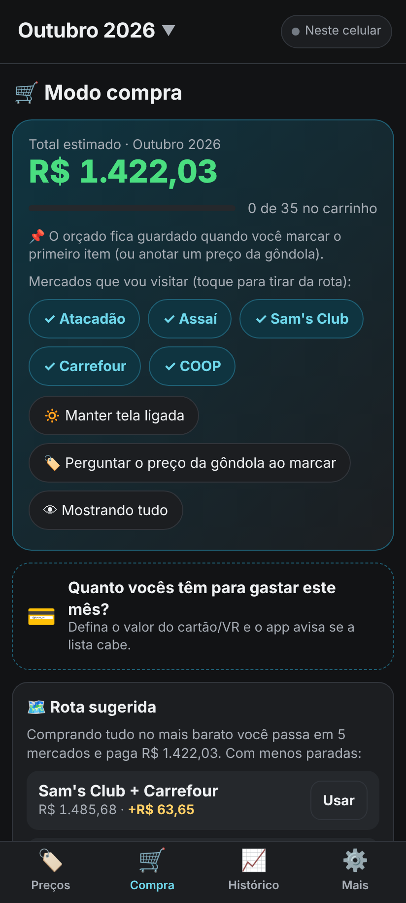 **Modo compra e rota** | 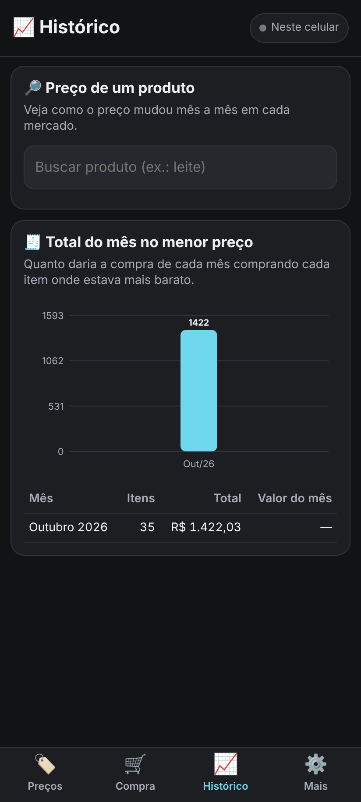 **Histórico do mês** |
| 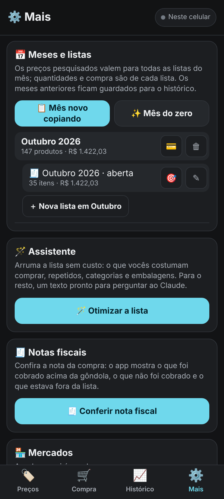 **Listas, notas, assistente** | 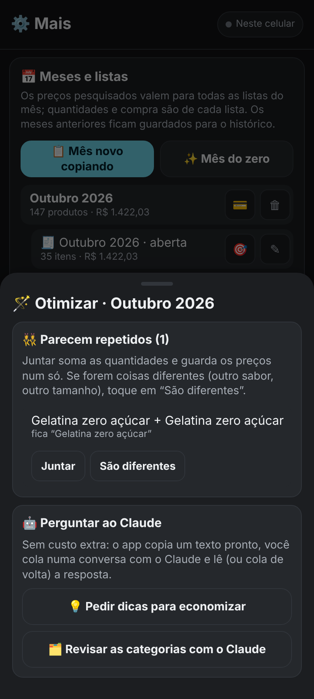 **Otimizar a lista** | 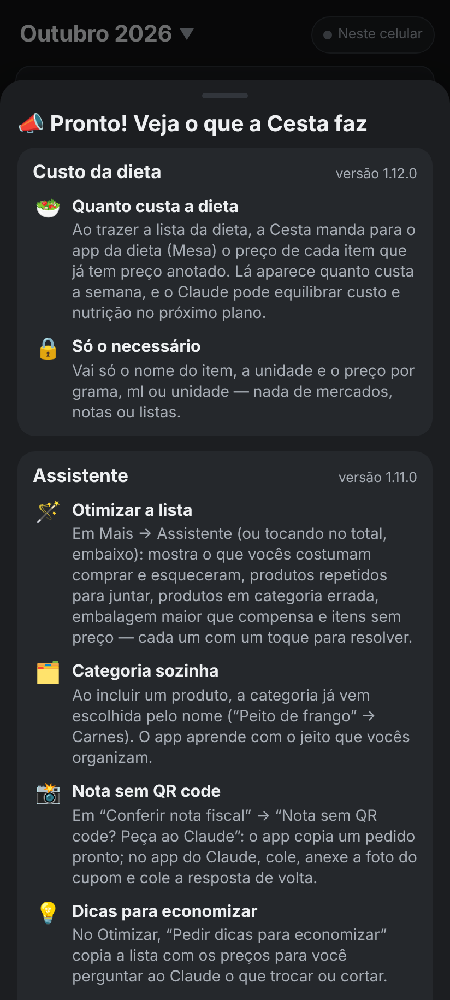 **O que o app faz** | 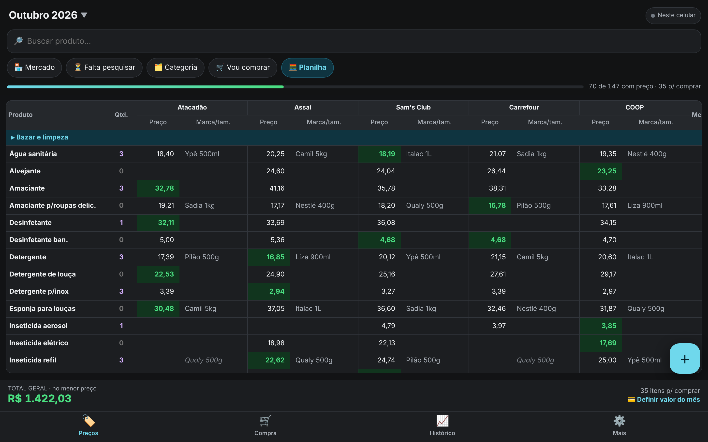 **Planilha no computador** |

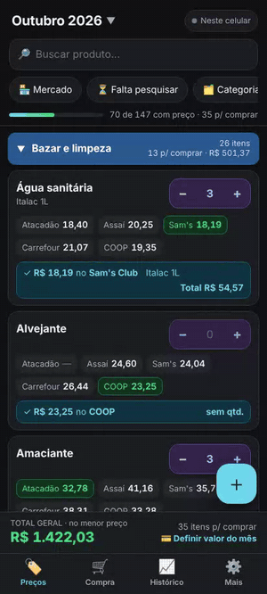 
<i>Preços por mercado, o mais barato em destaque, depois o modo compra com a rota sugerida e o histórico do mês.</i>

- **Pesquisa** — uma lista por mês (e listas extras), preço por mercado com marca e tamanho, o mercado mais barato de cada
  item, o total do mês no menor preço, preço por kg / L / unidade entre embalagens, aviso de variação contra os meses
  anteriores, marcas aceitas por produto, digitação de valor como app de banco.
- **Compra** — lista por mercado com rota sugerida ("menos paradas: dois mercados por R$ 63 a mais"), valor do mês (ok /
  quase / passou), preço da gôndola na hora com alerta quando passa 10% do previsto e está mais barato em outro mercado,
  compartilhada entre os celulares em tempo real.
- **Depois de pagar** — lê a nota fiscal eletrônica (NFC-e), liga cada linha a um produto, aprende os códigos de cada loja e
  mostra o que foi cobrado acima da gôndola ou do previsto.
- **Assistente sem API paga** — "Otimizar a lista" (costuma comprar e esqueceu, repetidos, categoria errada, embalagem maior
  que compensa, itens sem preço) com um toque para resolver; categoria sugerida pelo nome; pedidos prontos para colar no
  Claude (nota sem QR code, dicas para economizar).
- **Planilha de ida e volta** — importa e exporta o formato Excel original da família, para nada se perder na mudança.

## Como funciona

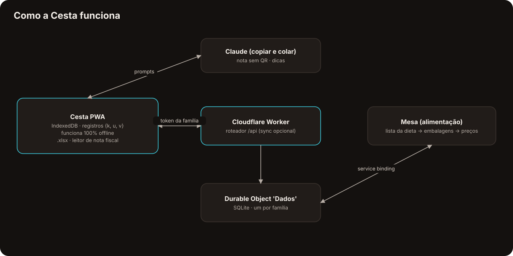

O diferente: **o celular é o banco de dados.** Cada fato — um preço, uma quantidade, uma marca, uma linha da nota — é um
registro `{k, u, v}` no IndexedDB; vence o carimbo maior e apagar deixa lápide. O app funciona 100% offline e a
sincronização é opcional: um único Durable Object do Cloudflare (SQLite) guarda os mesmos registros para a família, com a
mesma regra. Não há build nem dependência — até o leitor e o gerador de `.xlsx` são escritos à mão sobre o
`CompressionStream`.

O leitor de nota trabalha com o texto da página pública da Sefaz (copiado pelo usuário), não com robô: a página é protegida
contra acesso automático e o app respeita isso.

## Segurança

A sincronização é protegida por uma senha da família que nunca sai do celular: o app manda um token SHA-256 e o servidor
guarda só um hash dele. A leitura da nota descarta dados pessoais (CPF, nome, número de sócio). Links só são aceitos de
`https://*.gov.br`. Detalhes em [SECURITY.md](SECURITY.md).

## Destaques de engenharia

- **Sem dependências e sem build** — módulos ES puros, cache no service worker, leitor/gerador de `.xlsx` (ZIP + XML) à mão.
- **Números que batem com a planilha** — um teste opcional compara os totais do mês do app com o Excel original, centavo a centavo.
- **Leitor de nota** testado contra uma NFC-e real (anonimizada), com códigos, quantidades, descontos e o mercado da loja.
- **Aprende sem IA** — o vínculo produto/nota e a sugestão de categoria aprendem com o que a família faz, com regras que
  nunca chutam quando há empate.
- **44 testes do modelo** e um ponta a ponta com Playwright do app inteiro: dois celulares, offline, notas, planilha e a
  integração com o app de alimentação com os dois Workers rodando localmente.

## Tecnologias

JavaScript (ES2023, sem framework) · IndexedDB · Service Worker · CompressionStream (.xlsx) · Cloudflare Workers · Durable
Objects (SQLite) · Service bindings · Claude (pedidos para copiar e colar) · test runner do Node · Playwright

## Para ler mais

- [Estudo de caso](docs/case-study.pt-BR.md) — o problema, as decisões e o que saiu delas.
- [Segurança](SECURITY.md) — modelo de ameaças e como cada camada funciona.

## O conjunto

| | |
|---|---|
| [**Lastro**](https://github.com/BeBernos/Lastro-Business) | Finanças da família — caixa, cartão e investimentos, com criptografia de ponta a ponta |
| [**Mesa**](https://github.com/BeBernos/Mesa-Business) | Plano alimentar da família, montado por IA |
| [**Pulse**](https://github.com/BeBernos/Pulse-Business) | Treino de força com programas montados por IA e animações 2D/3D dos exercícios |
| **Cesta** | Pesquisa de preços de mercado (este repositório) |

## Sobre

Concebido e construído por **Bruno Bernos** — produto, UX e engenharia — com o Claude Code como par de programação.
Contato: [github.com/BeBernos](https://github.com/BeBernos).

## Licença

Copyright © 2026 Bruno Bernos. **Todos os direitos reservados.** O código está publicado só para avaliação; não há
permissão para usar, copiar, modificar ou distribuir. Há licenças comerciais (apps de supermercado e fidelidade,
cooperativas de compra, produtos de orçamento e educação financeira) — veja a [LICENSE](LICENSE) e fale comigo.
