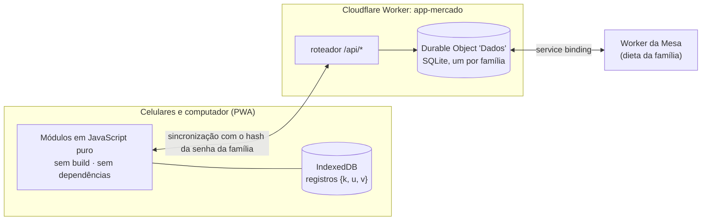

<p align="center"></p>

<h1 align="center">Cesta</h1>
<p align="center"><b>Pesquisa de preços de supermercado que se paga — compare mercados, faça a rota mais barata, confira a nota.</b></p>

<p align="center">
  <a href="README.md">🇺🇸 Read in English</a> ·
  <a href="#demonstração">Demonstração</a> ·
  <a href="#arquitetura">Arquitetura</a> ·
  <a href="#uso-comercial">Uso comercial</a>
</p>

<p align="center">
  
  
  
  
  
</p>

---

A Cesta substitui a planilha de compras do mês da casa. Antes de comprar, os preços são pesquisados em vários mercados; o
app mostra o mercado mais barato de cada item, o total do mês no menor preço e a melhor rota de mercados. No mercado vira
lista de compra, anota o preço da gôndola, e depois de pagar lê a nota fiscal eletrônica (NFC-e) para conferir o que foi
cobrado de verdade.

> Todos os preços, notas e dados deste repositório e das imagens são fictícios.

## Demonstração

<p align="center"></p>

| Pesquisa de preços | Um produto, cinco mercados | Modo compra e rota | Histórico do mês |
|---|---|---|---|
|  |  |  |  |

| Listas, notas, assistente | Otimizar a lista | Novidades |
|---|---|---|
|  |  |  |

**No computador** — vista de planilha para quem pensa em linhas e colunas:


## O que faz

**Pesquisa**
- Uma lista por mês (e listas extras), produtos por categoria, preço em cada mercado com marca e tamanho.
- Mercado mais barato por item, total do mês no menor preço, preço por kg / L / unidade entre embalagens diferentes,
  aviso de variação contra os meses anteriores, marcas aceitas por produto.
- Digitação de valor como app de banco, repetir as quantidades do mês passado, busca e filtros.

**Compra**
- Modo compra por mercado com rota sugerida (ex.: "menos paradas: Sam's + Carrefour por só R$ 63 a mais"), valor do mês ou da lista
  (ok / quase / passou), preço da gôndola com alerta quando está ≥10% acima do previsto e mais barato em outro mercado.
- Compartilhada entre os celulares em tempo real quando a sincronização está ligada.

**Depois de pagar**
- Lê a nota fiscal eletrônica (texto copiado do site da Sefaz ou foto pelo assistente), liga cada linha a um produto,
  aprende os códigos de cada loja e mostra o que foi cobrado acima da gôndola ou do previsto.

**Assistente sem API paga**
- "Otimizar a lista": o que vocês costumam comprar e esqueceram, repetidos, categoria errada, embalagem maior que compensa,
  itens sem preço — cada um com um toque para resolver. Categoria sugerida pelo nome (regras + memória do que vocês fazem).
- Pedidos prontos para copiar e colar no Claude: nota sem QR code, revisão de categorias, dicas para economizar.

**Integrações e dados**
- Traz a lista de compras da dieta da família da [Mesa](https://github.com/BeBernos/Mesa-Business) (convertida em
  embalagens pelo tamanho da marca) e devolve o preço por grama/ml/unidade, para a Mesa mostrar quanto custa a dieta.
- Importa e exporta o formato da planilha Excel original (`.xlsx` escrito do zero com `CompressionStream`).

## Arquitetura



- **Local primeiro:** tudo funciona offline; cada registro é `{k, u, v}` e vence o carimbo maior, apagar deixa lápide — a
  mesma regra em todos os celulares e no servidor.
- **Sincronização opcional:** um Durable Object com SQLite (plano grátis). A senha da família nunca sai do celular: o app
  manda um token SHA-256 e o servidor guarda só um hash dele.
- **Sem build e sem dependências:** módulos ES, cache no service worker, leitor/gerador de `.xlsx` escrito à mão.

## Qualidade

- 44 testes com o test runner do Node cobrindo o modelo (preços, totais iguais aos da planilha original, orçamento, notas,
  vínculos, rota, regras do assistente, embalagens e preço da dieta).
- Ponta a ponta com Playwright do app inteiro (dois celulares, offline, notas, planilha e a integração com a Mesa com os dois
  Workers rodando localmente).

## Rodar localmente

```bash
npm test
npx wrangler dev --port 8787        # http://localhost:8787 (sincronização + integração com a dieta)
# ou sirva só a pasta app/: funciona offline sem o servidor
```

## Uso comercial

Este repositório tem **código visível, mas não é open source**: dá para ler e avaliar o código, mas uso em produção ou
comercial exige licença. Há licenças para **implantações white-label** (apps de fidelidade de supermercado, cooperativas de
compra, produtos de orçamento e educação financeira) e desenvolvimento sob medida. Veja a [LICENSE](LICENSE) e fale comigo
pelo [github.com/BeBernos](https://github.com/BeBernos).

## Faz parte de um conjunto

| | |
|---|---|
| [**Mesa**](https://github.com/BeBernos/Mesa-Business) | Plano alimentar da família, montado por IA |
| [**Pulse**](https://github.com/BeBernos/Pulse-Business) | Treino de força com programas montados por IA e animações 2D/3D dos exercícios |
| **Cesta** | Pesquisa de preços de supermercado (este repositório) |
